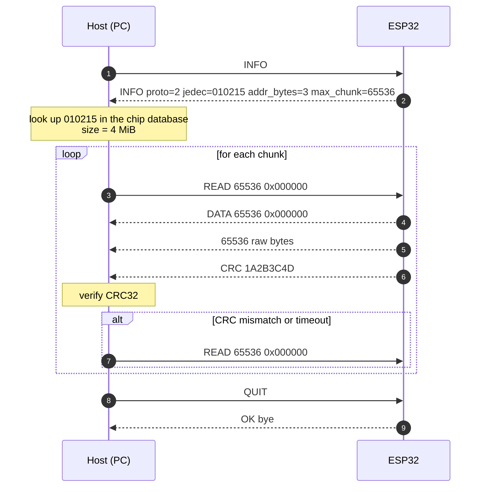

# Protocol

This document explains how the project's protocol works and how to use it.


## Overview

The protocol is message-based. This means that it can either be used in a fluid work-flow or separately (sending single messages).
The `esp32-dumper` CLI allows `--send` utilization to use single protocol messages.

The host is the orchestrator: it asks the device for information, looks up the flash chip in its own database, and then requests the dump range by range. The device is a stateless SPI engine: it answers `INFO`, reads the requested range, and streams it back with a CRC.

## Transport

The protocol is a byte stream and is transport-agnostic. It can run over:

- USB-Serial-JTAG (primary transport on ESP32-S3/C3/C6/H2),
- UART (ESP32 classic and boards with USB-UART bridges),
- TCP (future, for WiFi transports).

The same framing applies to every transport.

## Framing

Every message starts with an ASCII **header** terminated by `\n`. Depending on the message, a **payload** and/or an ASCII **trailer** may follow.

```text
+--------------------------------------+
| Header (ASCII, ends with \n)         |
+--------------------------------------+
| Payload (raw bytes, optional)        |
+--------------------------------------+
| Trailer (ASCII, ends with \n)        |
+--------------------------------------+
```

### Header

- ASCII text, one line, terminated by `\n`.
- Fields are separated by a single space.
- Message names are case-sensitive and uppercase.
- A host must tolerate `\r\n` line endings, but the device sends `\n`.
- The header of a `DATA` response contains the number of payload bytes, so the host knows exactly how many bytes to read. This is what makes binary payloads unambiguous.

### Payload

- Raw bytes, exactly `bytes` long.
- No escaping and no text encoding.
- It can contain `\0`, `\n`, `\r`, `0xFF`, or any other byte.
- The host must read it with an exact-length read, **not** with `readline()`.

### Trailer

- ASCII text, one line, terminated by `\n`.
- It is sent **after** the payload.
- The `DATA` trailer is `CRC <crc32>`.

Example of a complete `DATA` frame:

```text
DATA 65536 0x000000\n
<65536 raw bytes>
CRC 1A2B3C4D\n
```

The payload is immediately followed by the ASCII `CRC` trailer; no separator is added. Because the host knows `bytes`, it can find the boundary even if the last payload byte is `\n`.

## Message flow



In plain text:

```text
Host                                Device
 |                                    |
 |-- INFO --------------------------->|
 |<-- INFO proto=2 jedec=... ---------|
 |                                    |
 |-- READ 65536 0x000000 ------------>|
 |<-- DATA 65536 0x000000 ------------|
 |<-- 65536 raw bytes ----------------|
 |<-- CRC 1A2B3C4D -------------------|
 |                                    |
 |-- READ 65536 0x010000 ------------>|
 |<-- DATA 65536 0x010000 ------------|
 |<-- 65536 raw bytes ----------------|
 |<-- CRC 5E6F7A8B -------------------|
 |                                    |
 |-- QUIT --------------------------->|
 |<-- OK bye -------------------------|
```

## Messages

### `INFO`

- Sender: Host
- Type: Request
- Parameters: None
- Expects: `INFO` response
- Expected Errors: [1|2|4|5|6] *see [Error codes](#error-codes)*
- Summary: `INFO` is sent in order to get information about the board. It asks the device to respond with an informational component: protocol version, JEDEC ID, addressing width, maximum chunk size, and firmware version.
- Example: `INFO`

### `INFO` (response)

- Sender: Device
- Type: Response
- Parameters:
  - `proto=<n>`: protocol version, integer.
  - `jedec=<6 hex digits>`: JEDEC ID without spaces, e.g. `010215`.
  - `sfdp=<0|1>`: whether the device can read SFDP (reserved for a future message).
  - `addr_bytes=<3|4>`: address width used on the SPI wire.
  - `max_chunk=<bytes>`: maximum number of bytes accepted in one `READ`.
  - `max_flash=<bytes>`: maximum linear address range accepted by the firmware.
  - `fw=<version>`: firmware version.
- Expects: Nothing
- Expected Errors: None; if the request is invalid, the device sends `ERR` instead.
- Summary: Describes the device capabilities. The host must ignore unknown `key=value` fields to allow forward-compatible additions.
- Example: `INFO proto=2 jedec=010215 sfdp=0 addr_bytes=3 max_chunk=65536 max_flash=16777216 fw=0.1.0`

### `READ`

- Sender: Host
- Type: Request
- Parameters:
  - `<bytes>`: number of bytes to read. Unsigned integer, decimal or `0x`-prefixed hex. Must be greater than 0 and less than or equal to `max_chunk`.
  - `<addr>`: start address. Unsigned integer, decimal or `0x`-prefixed hex. Must satisfy `addr + bytes <= max_flash`.
- Expects: `DATA` response, or `ERR` if the request is invalid.
- Expected Errors: [1|2|4|5|6] *see [Error codes](#error-codes)*
- Summary: Requests a range of flash memory. The device reads the range and streams it back using the `DATA` frame. The host is responsible for choosing chunk boundaries and for retrying failed chunks.
- Example: `READ 65536 0x000000`

### `DATA`

- Sender: Device
- Type: Response
- Parameters: header `<bytes> <addr>`; then exactly `<bytes>` raw bytes; then the `CRC` trailer.
- Expects: Nothing
- Expected Errors: N/A. If the request is invalid, the device sends `ERR` instead of `DATA`.
- Summary: Streams the requested range. The header repeats the request parameters so the host can validate that the response matches the request. The payload is raw binary and is followed by a `CRC` trailer.
- Example:

```text
DATA 65536 0x000000
<65536 raw bytes>
CRC 1A2B3C4D
```

### `CRC`

- Sender: Device
- Type: Trailer (part of a `DATA` response)
- Parameters: `<crc32>`: 8 uppercase hexadecimal digits.
- Expects: Nothing
- Expected Errors: N/A
- Summary: CRC32 of the payload bytes only, using the standard CRC-32/ISO-HDLC variant (the same as `zlib.crc32`). The header is not included. If the host's CRC does not match, the host must re-send the same `READ`.
- Example: `CRC 1A2B3C4D`

### `QUIT`

- Sender: Host
- Type: Request
- Parameters: None
- Expects: `OK` response
- Expected Errors: [1|2|4|5|6] *see [Error codes](#error-codes)*
- Summary: Ends the current session and returns the device to its idle state. It does not reset the device or the flash.
- Example: `QUIT`

### `OK`

- Sender: Device
- Type: Response
- Parameters: Optional human-readable message.
- Expects: Nothing
- Expected Errors: N/A
- Summary: Generic success response.
- Example: `OK bye`

### `ERR`

- Sender: Device
- Type: Response
- Parameters:
  - `<code>`: numeric error code.
  - `<message>`: short machine-readable message without spaces.
- Expects: Nothing
- Expected Errors: N/A
- Summary: Indicates that the request could not be completed. No payload or trailer follows an `ERR` response.
- Example: `ERR 2 invalid-parameters`

## Error codes

| Code | Name | Meaning |
|---:|---|---|
| 1 | `unknown-message` | The message name is not recognized. |
| 2 | `invalid-parameters` | Missing, malformed, or out-of-range parameters. |
| 3 | `crc-mismatch` | Reserved for verification commands and future use. |
| 4 | `busy` | The device is busy and cannot handle the request. |
| 5 | `timeout` | An internal operation timed out. |
| 6 | `internal-error` | Unexpected internal error. |

## Limits and validation

- `bytes` must be greater than 0.
- `bytes` must be less than or equal to `max_chunk`.
- `addr + bytes` must be less than or equal to `max_flash`.
- The device must reject invalid ranges with `ERR 2 invalid-parameters`.
- The device must never overflow its buffers, even if the host sends an invalid request.
- The host must validate the `DATA` header against the original `READ` request.
- The host must read exactly `bytes` payload bytes, then read the `CRC` line.
- The host must treat a short read, a timeout, or a missing `CRC` as a failed chunk and retry.


Rules:

1. Before resuming, verify that the current `jedec`, `size`, `chunk_size`, and protocol version match the metadata. If they do not match, abort instead of mixing dumps.
2. Request only the chunks with `ok=false` or missing chunks.
3. Write each chunk at its offset in the `.part` file (`seek` + `write`).
4. Update the metadata atomically after each successful chunk (write a temporary file, then rename it).
5. When all chunks are complete, compute the full CRC32 and SHA256, rename `.part` to `.bin`, and update the metadata.

## Versioning

- `proto` is a major protocol version.
- The host must reject an unknown major version with a clear error.
- New `INFO` fields may be added without changing `proto`; hosts must ignore unknown fields.
- New message types may be added in a major version. The device must respond to unknown messages with `ERR 1 unknown-message`.
- Breaking changes to framing, field order, or semantics require a new major version.

## Legacy v1 (current firmware)

The firmware currently in `main/` implements a simpler protocol:

```text
Device -> READY\n
Host   -> D (one byte, 0x44)
Device -> 4 MiB raw bytes
Device -> \nCRC32:XXXXXXXX\n
Device -> READY\n
```

Characteristics:

- The size is fixed at 4 MiB; there is no address or length.
- The host sees one continuous stream; the device reads internally in 4 KiB blocks, but those blocks are invisible to the host.
- There is one CRC32 at the end, over the whole dump.
- There is no error frame and no resume.
- `D` means "start dump" in v1. In v2 the data response is called `DATA` to avoid that collision.

The host should support v1 while the firmware is migrated, then deprecate it.
